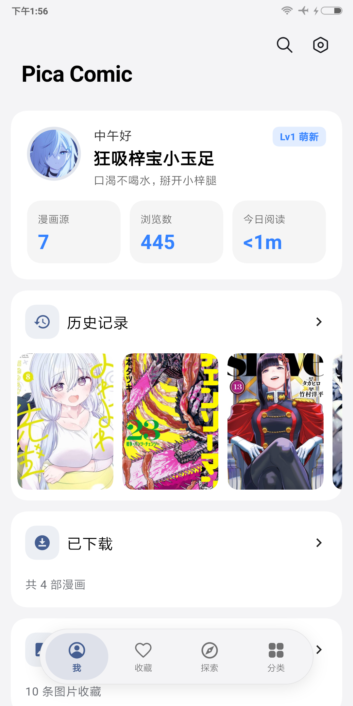
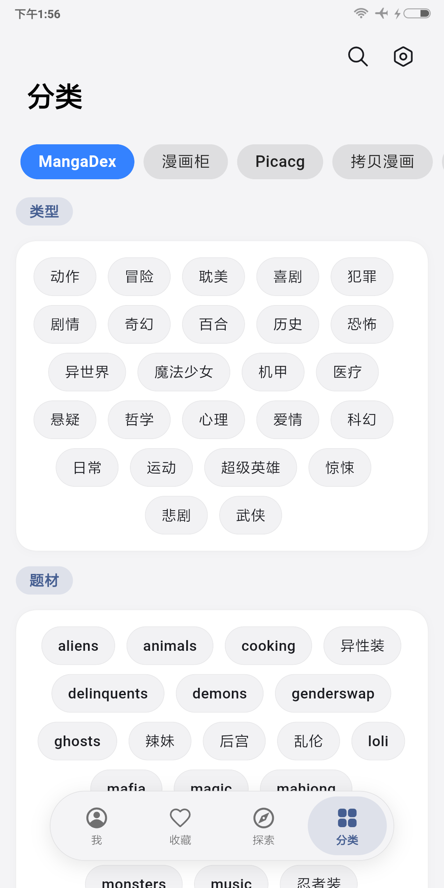
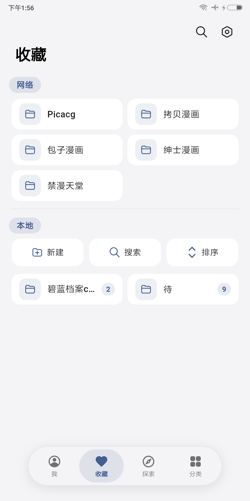

<div align="center">


# PicaComic · MIUIX

**基于 Flutter 的多源漫画客户端分支，界面全面迁移至 HyperOS / MIUIX 风格。**

[](https://github.com/Qilaiwing/PicaComic_miuix/releases/tag/v4.3.1-miuix)
[](https://github.com/Qilaiwing/PicaComic_miuix/releases)
[](https://github.com/Qilaiwing/PicaComic_miuix/releases)


[](LICENSE)

</div>

---

## 界面截图

<p align="center">
  
  
  
  
</p>
<p align="center"><sub>首页 · 探索 · 分类 · 收藏</sub></p>

---

## 目录

- [界面截图](#界面截图)
- [这是什么](#这是什么)
- [核心特性](#核心特性)
- [下载与安装](#下载与安装)
- [从源码构建](#从源码构建)
- [内置与可安装漫画源](#内置与可安装漫画源)
- [已知说明](#已知说明)
- [许可证与致谢](#许可证与致谢)

---

## 这是什么

**PicaComic** 是一个优秀的开源多源漫画客户端：支持内置源与 JavaScript 漫画源插件，覆盖探索、搜索、收藏、下载与阅读。

本仓库（`miuix` 分支）在 [Pacalini/PicaComic](https://github.com/Pacalini/PicaComic) 之上，把界面整体迁移到 **HyperOS / MIUIX** 设计语言，并继续完善源管理、目录选择、阅读性能与应用内更新等能力。

本分支专注以下几件事：

1. **MIUIX 全界面**：按钮、开关、列表、对话框、弹窗、菜单、Tab、Scaffold 等统一为 Miuix 组件，顶栏毛玻璃与悬浮胶囊底栏。
2. **漫画源管理**：内置源与账号同页管理；可从本分支漫画源仓库安装 JS 源，支持连通性检测与网页登录。
3. **阅读与下载体验**：多模式阅读器、自定义漫画下载 / 图片保存目录（系统文件管理器选文件夹）、应用内检查更新。
4. **仅 Android**：本仓库正式发布仅面向 Android（arm64-v8a）。其他桌面 / iOS 平台请使用上游项目。

> **AI 辅助声明**  
> 本仓库的界面迁移与相关代码修改在 AI 辅助下完成，可能存在未发现的问题。欢迎在 [Issues](https://github.com/Qilaiwing/PicaComic_miuix/issues) 反馈。

---

## 核心特性

### 1. 外观与交互

- **HyperOS / MIUIX 风格**：圆角、色彩、列表与弹窗统一；关于页、设置页、详情页等按 Miuix 重做。
- **毛玻璃顶栏**：内容可滚至栏下；可关闭毛玻璃，关闭后顶栏 / 底栏改为纯色底，更省电。
- **悬浮胶囊底栏**：四个主 Tab 保活切换，减少闪烁与重建抖动。
- **HyperOS 风格转场**：子页边缘滑出返回；根页切换直接到位，避免透明闪帧。

### 2. 漫画源与网络

- **内置源**：`picacg` · `ehentai` / `exhentai` · `jmcomic` · `hitomi` · `htcomic` · `nhentai`。
- **JS 漫画源**：可从本分支源仓库（`index.json`）挑选安装；支持网页登录、评论（视源能力）、单章节预览。
- **源管理合一**：漫画源与账号登录合并同一页面；连通性检测卡片显示延迟状态。
- **代理与传输**：沿用上游 HTTP / SOCKS5 等网络能力。

### 3. 阅读器

- **多种阅读方向**：连续滚动、左右翻页等模式。
- **阅读控制**：音量键翻页、屏幕常亮、章节顶栏显示、阅读进度续读。
- **性能优化**：翻页减少整页重建、连续阅读隔离重绘与预解码节流，改善掉帧。

### 4. 收藏、历史与下载

- **本地与网络收藏**：多文件夹、网络书架；收藏列表顶栏间距对齐。
- **阅读历史与统计**：我的页展示今日阅读时长，可进入阅读统计。
- **下载与本地书架**：章节多选下载；可自定义漫画下载目录。
- **图片保存**：可自定义保存目录，默认写入系统相册（摘要不暴露真实私有路径）。

### 5. 设置与更新

- **目录选择**：默认私有目录只显示简短说明；自定义通过系统文件管理器选文件夹，可重置。
- **屏幕刷新率**：跟随系统 / 高刷 / 60Hz。
- **应用内更新**：检查更新弹窗展示更新日志；关于页可查看当前版本说明。
- **备份恢复**：包含更多设置项与搜索历史等数据。

---

## 下载与安装

预编译 APK 请前往 **[Releases](https://github.com/Qilaiwing/PicaComic_miuix/releases)** 下载。

| 项目 | 说明 |
| :--- | :--- |
| 包名 | `com.picacomic_miuix` |
| 架构 | **arm64-v8a**（正式版目前仅此一种） |
| 安装包示例 | `PicaComic-Miuix-4.3.1-arm64-v8a.apk` |
| 系统要求 | Android 7.0（API 24）及以上 |

> 正式版使用独立签名。若从调试包或旧签名升级失败，请先卸载再安装。

---

## 从源码构建

### 环境要求

- Flutter **3.41.x**
- JDK **17**
- Android SDK（含 Platform / Build-Tools）

### 常用命令

```shell
git clone --recursive -b miuix https://github.com/Qilaiwing/PicaComic_miuix.git
cd PicaComic_miuix
flutter pub get
flutter build apk --release --split-per-abi --target-platform android-arm64
```

产物位于 `build/app/outputs/flutter-apk/`，正式包名形如 `PicaComic-Miuix-<version>-arm64-v8a.apk`。

---

## 内置与可安装漫画源

| 类型 | 来源 |
| :--- | :--- |
| 内置 | picacg、ehentai / exhentai、jmcomic、hitomi、htcomic、nhentai |
| 可安装 JS 源 | 本分支漫画源仓库（应用内「添加漫画源」） |

漫画阅读、搜索、下载等核心协议沿用上游；各站点请遵守对应服务条款，本仓库仅供学习与个人使用。

---

## 已知说明

- **平台范围**：本分支正式维护 Android；iOS / macOS / Windows / Linux / Web 请使用 [上游项目](https://github.com/Pacalini/PicaComic)。
- **预测性返回**：已移除系统预测性返回相关实现，避免背景色异常与额外卡顿；返回手势仍为边缘滑出。
- **第三方图源**：站点可用性取决于对方服务，与本应用版本无关。

---

## 许可证与致谢

- **协议**：本项目基于 **MIT License** 开源，详见 [LICENSE](LICENSE)。
- **上游致谢**：
  - [Pacalini/PicaComic](https://github.com/Pacalini/PicaComic) — 本分支上游
  - [nyne / wgh136](https://github.com/wgh136) — 原作者
- **组件与资源**：
  - [flutter_miuix](https://github.com/ChuxinNeko/flutter_miuix)（Apache-2.0）— 以修改版形式内置于 `packages/flutter_miuix`，修改说明见 `packages/flutter_miuix/MODIFICATIONS.md`
  - [JMComic-qt](https://github.com/tonquer/JMComic-qt) — JM 图片重排参考
  - [EhTagTranslation](https://github.com/EhTagTranslation/Database) — 标签翻译